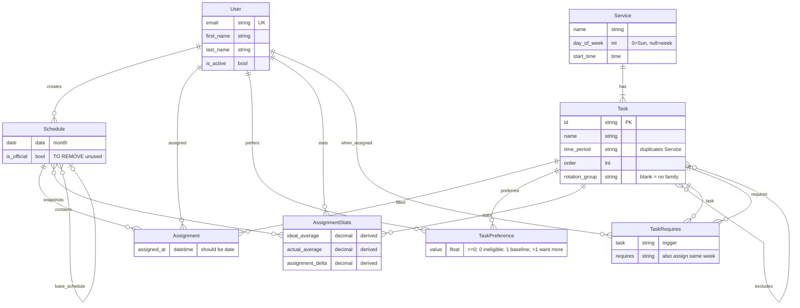

# service-scheduler 
 A django app for creating and fine-tuning "fair" schedules using 
 * [PuLP](https://coin-or.github.io/pulp/) optimization 
 * Postgresql
 * pdfkit

## Install
```bash
pip install -r requirements.txt
```

## Tests

Use the project venv. Django creates and destroys a test database (`test_servicescheduler`).

```bash
source venv/bin/activate
python manage.py test
```

A subset:

```bash
python manage.py test schedules.services.tests
python manage.py test schedules.tests.DeleteScheduleViewTests
python manage.py test schedules.tests.DeleteScheduleViewTests.test_other_user_cannot_delete
```

CBC runs on the real LP tests in `schedules.services.tests` (a few seconds). Verbose: `python manage.py test -v2`.

## Compare objectives

Generate months with one or more fairness objectives and print a KPI table (fill ratio, MAD, starved people, song-job counts, new-person month 1). Uses a throwaway test database, not Sunday’s data. The table always prints.

Congregation-sized snapshot (anonymized names/emails in `schedules/fixtures/compare/live.sql`):

```bash
source venv/bin/activate
python manage.py compare_objectives FairJobs --dump
python manage.py compare_objectives CatchUpShare FairJobs --dump --months 6
```

Refresh that file from the local Sunday database (rewrites names, emails, and passwords):

```bash
python manage.py dump_compare_db
```

Tiny fake roster is faster and is what the year-compare test uses:

```bash
python manage.py compare_objectives
python manage.py compare_objectives FairJobs
python manage.py compare_objectives CatchUpShare FairJobs
python manage.py compare_objectives FairJobs --months 6
```

`--dump` seeds the throwaway test database from `live.sql` and starts generating the month after the latest dumped assignment. Full-church CBC is slower than the tiny roster.

Names can be the class (`FairJobsObjective`) or a unique substring (`FairJobs`). Default is both objectives, 12 months each.

What the fields mean: docstring at the top of `schedules/services/year_compare.py`. Constraint asserts (infeasible/unfilled/exclusions) still live in `python manage.py test schedules.services.test_year_compare`.

## Seed your data
add data to `core/fixtures`

_read scripts for now to understand data format for now_

```bash
./manage.py seed_data
```


## Models

Volunteer is the login `User`. Single congregation; no `Church` table.



- **Service** — recurring event. `day_of_week` 0=Sunday; `null` = week-level.
- **Task** — role on a service. Symmetric `excludes` (cannot hold both in the same week); each task also excludes itself on save. `rotation_group` is a shared label for adjacent-week FairJobs rotation. Blank means no family. Migrate `0005` sets `song` (first/Sunday/Wednesday song leader), `prayer` (first/Sunday/Wednesday opening and closing), `lords_supper` (table lead/aid bread and cup).
- **TaskPreference** — `0` ineligible, `(0,1)` below baseline, `1` baseline, `>1` want more.
- **TaskRequires** — when this person is assigned `task`, also assign `requires` the same week. Skips that pair’s exclusion for them only. Directional. They need `p > 0` on both.
- **Schedule** — one month. Optional `base_schedule` (previous month, git-style parent). `is_official` is unused; history is Assignment rows.
- **Assignment** — person + task + datetime on a schedule. Source of truth for history and fairness. No unique `(schedule, task, assigned_at)`.
- **AssignmentStats** — derived snapshot (`ideal_average`, `actual_average`, `assignment_delta`), M2M to schedules. Recomputable from Assignment + preference. Lifetime share. FairJobs does not read it.

`Task.time_period` duplicates `Service.day_of_week`. `core` is seed-only.

Planned: charts, multi-church isolation, publish email, reminders, load — `docs/features/`.
