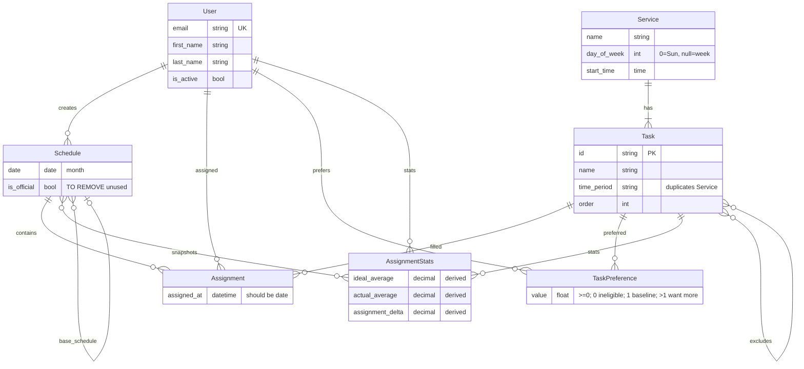

# Schema (current)

Renders in Cursor via Markdown Preview (Mermaid is built-in; optional: “Markdown Preview Mermaid Support”).

**Derived / redundant:** `AssignmentStats` (recomputable from Assignment + preference). `Task.time_period` vs `Service.day_of_week`. Task self-exclusion. `Schedule.base_schedule` git-branching. No unique `(schedule, task, assigned_at)`. No `Church`. Volunteer = login User.
